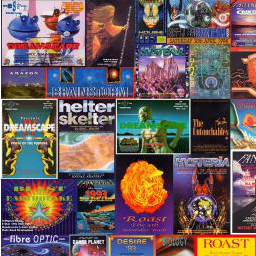
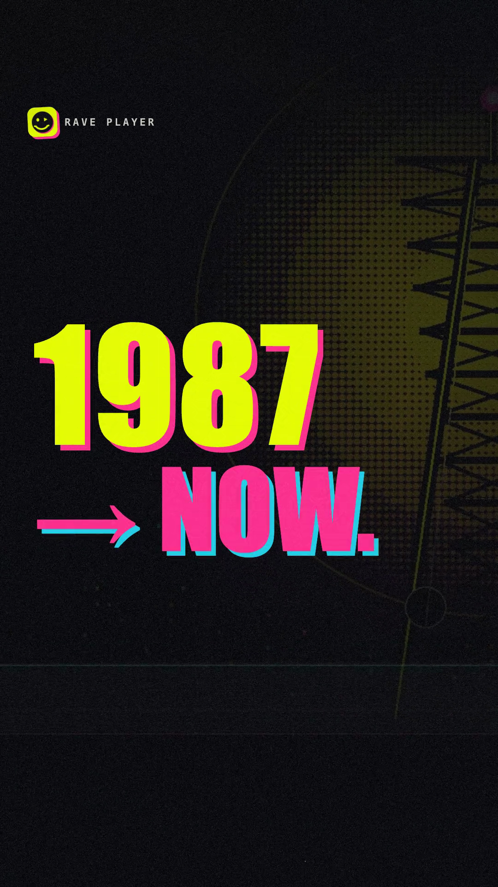
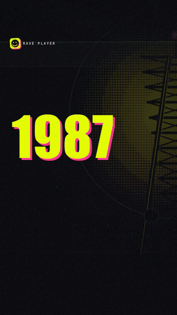
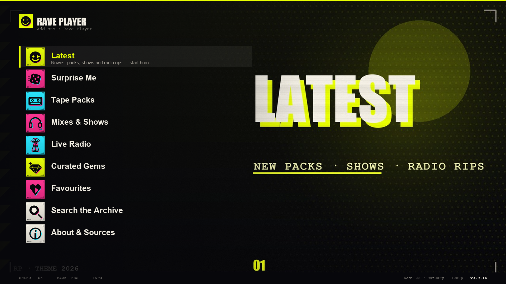
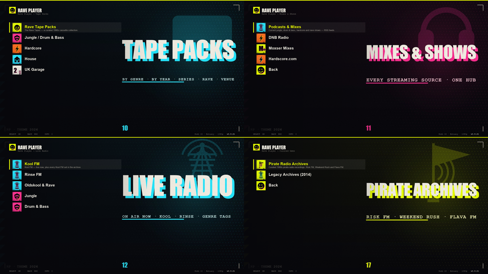
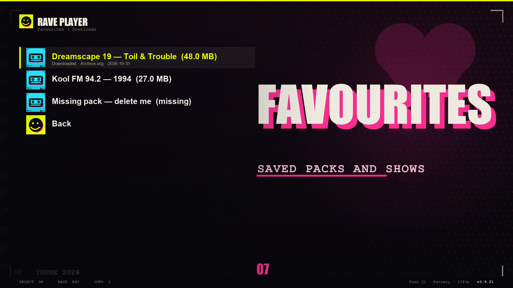
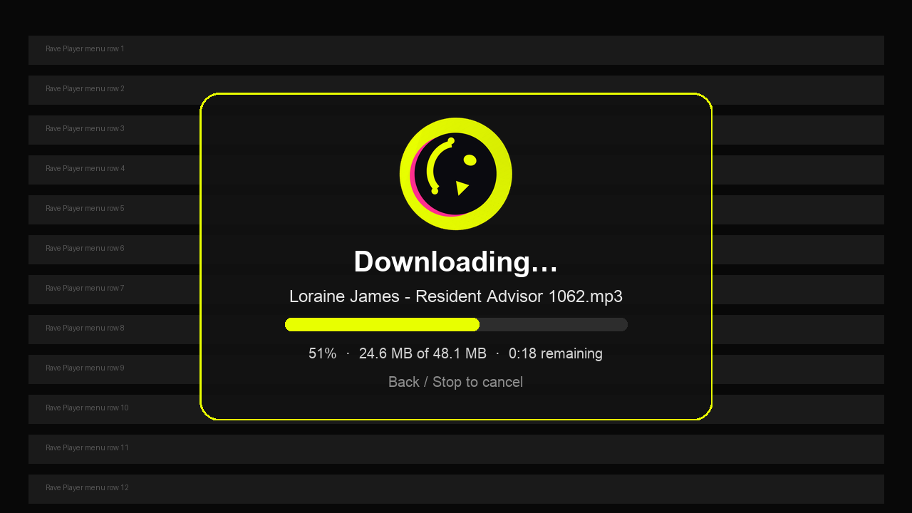

# Rave Player 3.0

Oldskool rave, jungle, hardcore, house & garage and pirate radio for Kodi —
rebuilt in 2026 from the 2014 original.



## Watch the advert

[](https://github.com/tcz009/plugin.audio.raveplayer/releases/tag/advert-2026)

[▶ Watch the 38-second advert](https://github.com/tcz009/plugin.audio.raveplayer/releases/tag/advert-2026) — 9:16 for Reels/Stories, 4:5 for the feed, 16:9 for YouTube.



## What it does

- **Rave tape packs, jungle, hardcore, house & garage** — pulled from the
  Internet Archive's public collections, streamed straight to Kodi.
- **Pirate radio archive and drum & bass sets** — Archive audio collections.
- **Live radio** — oldskool, jungle, drum & bass, hardcore, house/garage and
  pirate stations from [radio-browser.info](https://www.radio-browser.info/).
- **Search** — full-text search across the whole Archive from inside Kodi.
- **Latest / Surprise me / Tape Packs by Year** — newest across every
  source, a random pack, and a year-by-year browse of the collection.
- **Quick Filters** — Kool FM (live + archive sets), Dreamscape,
  Helter Skelter, Fantazia, One Nation, Centreforce, Don FM, Slammin' Vinyl.
  Defined in `resources/filters.json`, so new ones are data not code.
- **Favourites** — add any pack, show, station or episode from the context
  menu; stored in the add-on profile.
- **Play all / Shuffle pack** — context menu on a pack, or "Play all from
  here" on a track, straight from the remote.
- **Now playing** — the pack cover fills the Kodi artwork, and the plot shows
  the DJ, venue/event and date parsed from the Archive item title (best-effort;
  unknown titles are left unchanged).
- **Settings that matter** — results per page, episodes per podcast feed,
  live-station limit, and hiding empty feeds.
- **New archives (3.9.14)** — *Moxser Mixes* (direct MP3s from the Moxser
  sitemap), *Hardscore Archive* (RSS + post pages; direct MP3/M4A when
  present), *Rave Archive UK* and *GetDarker* (curated Mixcloud accounts —
  these open the source page, because Mixcloud streams are HLS and play in
  their own widget), and **Pirate Radio Archives** (curated Risk FM 107.1,
  Weekend Rush 92.3 and Flava FM recordings; `resources/pirate-radio.json`,
  same `station/year/title/djs/source_url/stream_url/credit` schema as the
  web app, with an optional `note` for unconfirmed pages).
- **Legacy sites** — the 2014 sources that are still standing:
  - *RaveTapePacks.com* — full tape packs. Its files are hotlink-protected, so
    playback URLs carry a `Referer` suffix that Kodi sends as a real header.
  - *JungleTapes.com* — 310 Toronto jungle/DnB radio shows from cassette,
    catalogued via the site sitemap.
  - *Toronto Rave Mixtape Archive* — first-class **Mixes & Shows** source from
    3.9.30: genre subfolders (Jungle & Hardcore, House & Techno, Studio,
    X-Static, plus extra nav genres), direct MP3 play/download, no hand-off.

## Menu (3.9.21 IA)

The root is nine journey rows, not a source inventory:

```
Latest · Surprise Me · Tape Packs · Mixes & Shows · Live Radio ·
Curated Gems · Favourites · Search the Archive · About & Sources
```

- **Tape Packs** — Rave Tape Packs · Jungle / Drum & Bass · Hardcore · House ·
  UK Garage · Pirate Stations · All Tape Packs · By Year · Classic Pack
  Series · By Rave & Venue.
- **Mixes & Shows** — Podcasts & Mixes · DNB Radio · Moxser Mixes ·
  Hardscore.com · Toronto Rave Mixtape Archive · GetDarker (dubstep/grime,
  when the Mixcloud add-on is installed).
- **Live Radio** — Kool FM · Rinse FM · Oldskool & Rave · Jungle · Drum & Bass ·
  Hardcore · House · UK Garage · Breakbeat.
- **Curated Gems** — Pirate Radio Archives · Rave Archive UK (when the Mixcloud
  add-on is installed) · Legacy Archives (2014).

- **Favourites → Downloads** — local files saved by the explicit download
  gesture (3.9.18); play offline, see size/date, delete file + metadata, and
  spot missing files. A Download context row appears only on direct MP3/M4A
  items from the five approved sources.

Every old destination is still reachable behind a hub with the same `mode=`/
`key=` values, so favourites and deep links keep working. Latest starts with
the curated "on air now" Kool/Rinse streams when available.

### Screenshots (3.9.20 layout, current 3.9.21 build)

<p>


</p>
<p>


</p>

The menu renders are generated from the add-on's real ListItem output by
`scripts/make-theme-shots.py`; the spinner preview is from
`docs/SPINNER-3.9.19.md`. The download spinner is opt-in and defaults off; the stream-tuning spinner (3.9.34) defaults on and closes before playback starts. Surprise Me has a 1.2 s animated reveal in 3.9.35 (setting: Animate Surprise Me).

### Kodi theme 2026 (3.9.16)

The nine root rows, four hubs and key sources now carry their own sticker icon
(256×256) and, when the skin shows focused-item fanart, their own 1280×720
fanart — the same bright spot-colour / ink-glyph language as the web build's
"The Last Transmission" art, re-cut for a TV list. The wordmark/logo are
untouched. Tokens, grids, the full asset map and what a Kodi add-on can and
cannot control are documented in [`docs/THEME-2026.md`](docs/THEME-2026.md);
before/after menu renders are in `docs/theme-2026/`. After updating, restart
Kodi once so the texture cache picks up the re-cut stickers.

### 2026 art rollout, Direction C2 (3.9.38)

The owner-approved C2 direction now covers **all 38 duplicated navigation
rows** and the **ten Live Radio station tiles**, not just the nine study
samples. Every row has its own sticker: nine C2 objects (cassette, labelled
tape, rave flyer, speaker stack, vinyl/turntable, acid smiley, glowsticks,
lazer beams, smiley balloon) in per-row poses, plus the station tiles for Kool
FM, Rinse FM, Oldskool & Rave, Jungle, Drum & Bass, Hardcore, House, UK Garage,
Breakbeat and Pirate Stations. Kodi renders 256×256 and the web build 512×512
from the same generator (`scripts/make-rollout-art.py`).

The 64 px review surface — all 38 rows plus the station tiles, on a dark list
panel — is `docs/theme-2026/final-rollout-sheet.png`. Two watch-list fallbacks
from the C2 rationale were applied because they read better without a caption:
rave-nights is a flyer (venue listings) and podcasts is a second cassette. UK
Garage is spelled `uk-garage` in art, route keys and tests; filenames are
lowercase kebab-case and `test/test_naming.py` enforces it.

**"Curated Gems" keeps that exact label** — the proposed Pirate & Rave Archives
rename is rejected.

## Kodi-only hand-off policy (3.9.16)

No row opens a browser or leaves Kodi. Sources that cannot be streamed
directly are handed to the official Kodi add-ons through `plugin://` paths:

| Source | Official add-on | Hand-off |
|---|---|---|
| Mixcloud (Rave Archive UK, GetDarker, cloudcasts) | `plugin.audio.mixcloud` | `?mode=40&key=<cloudcast path>` or `?mode=30&key=cloudcast&query=…` |
| YouTube links | `plugin.video.youtube` | `play/?video_id=<id>` or `search/?q=…` |

If the add-on is missing the row is hidden entirely — no dead links. 3.9.17
also gates raw platform URLs at the play resolver and the final list-item helper,
so a saved/deep-linked Mixcloud/YouTube page can never become a raw item URL.
**SoundCloud is not part of the Kodi build:** there is no content row and no
SoundCloud hand-off (links are ignored); it remains a plain About text credit
marked “web version only”. Direct sources (Moxser MP3s, Hardscore MP3s,
archive.org, tape packs, Kool/Rinse live) are unchanged. About & Sources is a
read-only credits screen.

## Sources & credits

Every source used by the Kodi add-on is credited here and in **About & Sources**
inside Kodi. All links were checked on 2026-11-01.

| Source | Link | Used for |
|---|---|---|
| Internet Archive | <https://archive.org/> | rave tape packs, collections and audio files |
| Mixcloud | <https://www.mixcloud.com/> | Rave Archive UK and GetDarker cloudcasts, via `plugin.audio.mixcloud` |
| YouTube | <https://www.youtube.com/> | links handed to `plugin.video.youtube` when the source provides one |
| SoundCloud | <https://soundcloud.com/> | **web version only** — no Kodi source row or hand-off |
| radio-browser.info | <https://www.radio-browser.info/> | live radio station directory |
| Moxser.com | <https://moxser.com/> | curated dance-music mix archive and direct MP3s |
| Hardscore.com | <https://www.hardscore.com/> | oldskool hardcore/jungle archive and direct MP3s |
| DNB Radio | <https://dnbradio.com/> | jungle/drum & bass shows and direct MP3s |
| GetDarker.com | <https://www.getdarker.com/> | dubstep/garage/underground sets via the Mixcloud add-on |
| Podcast & mix RSS feeds | <https://rss.com/> | Jungle Lab, Viper, Toro and the other shows |
| Pirate Radio Archives | <https://www.hardscore.com/> | curated Risk FM, Weekend Rush and Flava FM recordings; credits per recording |
| Kool FM / Rinse FM | <https://www.rinse.fm/> | live streams via `admin.stream.rinse.fm` |
| RaveTapePacks.com | <https://www.ravetapepacks.com/> | full tape packs (Referer-protected files) |
| JungleTapes.com | <https://jungletapes.com/> | 310 Toronto jungle/drum & bass radio shows |
| Toronto Rave Mixtape Archive | <https://www.torontoravemixtapearchive.com/> | 1990s Toronto rave mixtapes by genre; direct MP3 play/download |

## Downloads & offline (3.9.18)

Explicit downloads only (no auto-download). A **Download** action appears in
the context menu for direct MP3/M4A items from the five approved sources:
Archive.org tracks, Moxser mix MP3s, Hardscore MP3/M4A, Pirate Radio
Archives direct files and Toronto Rave Mixtape Archive MP3s. Podcast/RSS,
Legacy, GetDarker and all Mixcloud/SoundCloud/YouTube/live/HLS rows are not
downloadable.

- Files are written atomically through `xbmcvfs` to
  `special://userdata/downloads/raveplayer/` as
  `<sanitised-title>-<8hex>.mp3/.m4a`; cancel/failure leaves no partial file.
- Storage guard: 500 MiB per file, 2 GiB total, 256 MiB free-space reserve;
  size and free space are shown before starting.
- **Favourites → Downloads** lists local files with size/date, plays the local
  copy offline and deletes file + metadata. Missing files are marked and can be
  deleted.
- Context path: `RunPlugin(plugin://plugin.audio.raveplayer/?mode=download_start&url=…&title=…&source=…)`.

### Spinning-head download window (3.9.19 prototype, opt-in)

Enable **Settings → General → Spinning-head download window (prototype)** to
replace the plain download progress dialog with a small WindowXML overlay:
rotating Rave Player head (10 frames, 10 fps), filename, percent, done/total,
remaining time and “Back / Stop to cancel”. It is non-modal, updated from the
download loop, closes on success/cancel/failure, and silently falls back to the
ordinary `DialogProgress` if the window cannot be created. See
[`docs/SPINNER-3.9.19.md`](docs/SPINNER-3.9.19.md) for the spec, preview/GIF,
cost/risks and the opt-in recommendation. Default is **off**.

## Performance (3.9.20)

Warm root import+dispatch is ~0.08 s (was 0.78 s), the root route itself is
~0.0001 s, Latest cold is ~6 s / warm ~0.04 s, and cached pack open ~0.003 s.
Full methodology, before/after table and residual risks:
[`docs/PERF-3.9.20.md`](docs/PERF-3.9.20.md); reproduce with
`python3 scripts/benchmark.py`. No URL/label/route changes; 479 tests in 3.9.38.

## Why it was rebuilt rather than patched

The 2014 add-on was Python 2, ran on `xbmc.python` 2.1.0 (Kodi 13), and
depended on three modules that no longer exist in any current repository. It
also scraped ~30 fan sites with 70 bespoke regex functions, and most of those
sites are gone. Rewriting it as a thin layer over two maintained, public APIs
means a dead source can't take the whole add-on down with it.

## Requirements

- Kodi 20 (Nexus) through Kodi 22 (Piers)
- Nothing else. No module dependencies, no external binaries.

A self-hosted **web version** (same sources, runs in Docker) lives at
<https://github.com/tcz009/raveplayer-web>.

## Install from the repository (recommended)

Add the repository once, then Rave Player installs and updates itself.

1. Download **`repository.raveplayer-1.0.0.zip`** from the
   [repository 1.0.0 release](https://github.com/tcz009/plugin.audio.raveplayer/releases/tag/repo-1.0.0)
   and copy it somewhere Kodi can browse (NAS share, USB, `Downloads`).
2. Kodi → Add-ons → **Install from zip file** → pick that zip. Enable
   "Unknown sources" first if Kodi asks.
3. Add-ons → **Install from repository** → **Rave Player Repository** →
   Audio add-ons → **Rave Player** → Install.

After that, updates arrive through the repository — Kodi re-checks
`repo/addons.xml` daily, or on demand from the add-on's context menu.

## Install from the zip directly

1. Download `plugin.audio.raveplayer-<version>.zip` from the releases page.
2. Kodi → Add-ons → Install from zip file.

## Development

Everything is standard library plus Kodi's own modules.

```
raveplayer/
├── addon.xml
├── default.py              # entry point
├── resources/
│   ├── feeds.json          # podcast feeds (data, not code)
│   ├── filters.json        # quick filters (data, not code)
│   ├── pirate-radio.json   # curated Pirate Radio Archives (shared schema)
│   ├── settings.xml
│   └── lib/
│       ├── routes.py       # menu + routing (sections are data, not code)
│       ├── archive.py      # Internet Archive provider
│       ├── feeds.py        # RSS/Atom podcast provider
│       ├── dnbradio.py     # DNBRADIO.com recordings
│       ├── legacy.py       # ravetapepacks.com / jungletapes.com
│       ├── toronto.py      # Toronto Rave Mixtape Archive genre pages
│       ├── moxser.py       # Moxser sitemap/page provider
│       ├── hardscore.py    # Hardscore RSS/post provider
│       ├── getdarker.py    # GetDarker RSS + Mixcloud route
│       ├── mixcloud.py     # curated Mixcloud accounts (open page)
│       ├── pirate.py       # Pirate Radio Archives data loader
│       ├── handoff.py      # official Kodi add-on detection + plugin URLs
│       ├── downloads.py    # explicit offline downloads + local index
│       ├── radio.py        # radio-browser.info provider
│       ├── latest.py       # "Latest", "Surprise me", by-year queries
│       ├── favourites.py   # JSON favourites store
│       ├── ui.py           # list items and artwork
│       ├── http.py         # tiny HTTP transport
│       ├── cache.py        # best-effort on-disk response cache
│       └── kodi.py         # Kodi wrappers
└── test/
    ├── stubs/              # fake xbmc* modules
    └── run.py              # runs the routes outside Kodi
```

Smoke-test any route without Kodi:

```sh
# offline unit tests for the parsing/formatting layer
python3 -m unittest discover -s test -v

# live smoke tests against the real sources
python3 test/run.py root
python3 test/run.py archive_list key=rave page=1
python3 test/run.py archive_item id=dreamscape-19-toil-and-trouble-jungle-8-tape-pack-1995
python3 test/run.py radio_tag key=oldskool
python3 test/run.py legacy_menu
python3 test/run.py moxser
python3 test/run.py hardscore
python3 test/run.py pirate_menu
python3 test/run.py mixcloud_account key=getdarker
```

`build.yml` runs the unit tests, validates `addon.xml`, builds the zip and
attaches it to a release when you push a `v*` tag.

Build the installable zip and the Kodi repository layout:

```sh
./scripts/build.sh        # dist/plugin.audio.raveplayer-<version>.zip
./scripts/build-repo.sh   # repo/addons.xml + zip, for install-from-repo
```

Install straight onto an Android Kodi box over ADB (needs one `Allow debugging`
tap on the device; set the box's address explicitly):

```sh
SHIELD=<box-ip> ADB=adb ./scripts/install-shield.sh
```

Publish (creates the repository if missing):

```sh
GITHUB_TOKEN=ghp_xxx ./scripts/publish.sh
```

## Licence

GPL-3.0-or-later, same as the original. The add-on hosts nothing: everything
is streamed from third-party archives and radio directories.
