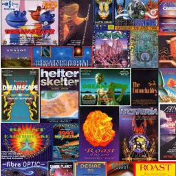

# Rave Player 3.0

Oldskool rave, jungle, hardcore, house & garage and pirate radio for Kodi —
rebuilt in 2026 from the 2014 original.



## What it does

- **Rave tape packs, jungle, hardcore, house & garage** — pulled from the
  Internet Archive's public collections, streamed straight to Kodi.
- **Pirate radio archive and drum & bass sets** — Archive audio collections.
- **Live radio** — oldskool, jungle, drum & bass, hardcore, house/garage and
  pirate stations from [radio-browser.info](https://www.radio-browser.info/).
- **Search** — full-text search across the whole Archive from inside Kodi.
- **Latest / Surprise me / Tape Packs by Year** — newest across every
  source, a random pack, and a year-by-year browse of the collection.
- **Quick Filters** — Kool FM (live + archive sets), Dreamscape,
  Helter Skelter, Fantazia, One Nation, Centreforce, Don FM, Slammin' Vinyl.
  Defined in `resources/filters.json`, so new ones are data not code.
- **Favourites** — add any pack, show, station or episode from the context
  menu; stored in the add-on profile.
- **Play all / Shuffle pack** — context menu on a pack, or "Play all from
  here" on a track, straight from the remote.
- **Settings that matter** — results per page, episodes per podcast feed,
  live-station limit, and hiding empty feeds.
- **Legacy sites** — the 2014 sources that are still standing:
  - *RaveTapePacks.com* — full tape packs. Its files are hotlink-protected, so
    playback URLs carry a `Referer` suffix that Kodi sends as a real header.
  - *JungleTapes.com* — 310 Toronto jungle/DnB radio shows from cassette,
    catalogued via the site sitemap.
  - *Toronto Rave Mixtape Archive* — 1990s Toronto rave mixtapes.

## Why it was rebuilt rather than patched

The 2014 add-on was Python 2, ran on `xbmc.python` 2.1.0 (Kodi 13), and
depended on three modules that no longer exist in any current repository. It
also scraped ~30 fan sites with 70 bespoke regex functions, and most of those
sites are gone. Rewriting it as a thin layer over two maintained, public APIs
means a dead source can't take the whole add-on down with it.

## Requirements

- Kodi 19 (Matrix) through Kodi 22 (Piers)
- Nothing else. No module dependencies, no external binaries.

A self-hosted **web version** (same sources, runs in Docker) lives at
<https://github.com/tcz009/raveplayer-web>.

## Install from the repository (recommended)

Add the repository once, then Rave Player installs and updates itself.

1. Download **`repository.raveplayer-1.0.0.zip`** from the
   [latest repository release](https://github.com/tcz009/plugin.audio.raveplayer/releases)
   and copy it somewhere Kodi can browse (NAS share, USB, `Downloads`).
2. Kodi → Add-ons → **Install from zip file** → pick that zip. Enable
   "Unknown sources" first if Kodi asks.
3. Add-ons → **Install from repository** → **Rave Player Repository** →
   Audio add-ons → **Rave Player** → Install.

After that, updates arrive through the repository — Kodi re-checks
`repo/addons.xml` daily, or on demand from the add-on's context menu.

## Install from the zip directly

1. Download `plugin.audio.raveplayer-<version>.zip` from the releases page.
2. Kodi → Add-ons → Install from zip file.

## Development

Everything is standard library plus Kodi's own modules.

```
raveplayer/
├── addon.xml
├── default.py              # entry point
├── resources/
│   ├── feeds.json          # podcast feeds (data, not code)
│   ├── filters.json        # quick filters (data, not code)
│   ├── settings.xml
│   └── lib/
│       ├── routes.py       # menu + routing (sections are data, not code)
│       ├── archive.py      # Internet Archive provider
│       ├── feeds.py        # RSS/Atom podcast provider
│       ├── dnbradio.py     # DNBRADIO.com recordings
│       ├── legacy.py       # ravetapepacks.com / jungletapes.com / Toronto
│       ├── radio.py        # radio-browser.info provider
│       ├── latest.py       # "Latest", "Surprise me", by-year queries
│       ├── favourites.py   # JSON favourites store
│       ├── ui.py           # list items and artwork
│       ├── http.py         # tiny HTTP transport
│       ├── cache.py        # best-effort on-disk response cache
│       └── kodi.py         # Kodi wrappers
└── test/
    ├── stubs/              # fake xbmc* modules
    └── run.py              # runs the routes outside Kodi
```

Smoke-test any route without Kodi:

```sh
# offline unit tests for the parsing/formatting layer
python3 -m unittest discover -s test -v

# live smoke tests against the real sources
python3 test/run.py root
python3 test/run.py archive_list key=rave page=1
python3 test/run.py archive_item id=dreamscape-19-toil-and-trouble-jungle-8-tape-pack-1995
python3 test/run.py radio_tag key=oldskool
python3 test/run.py legacy_menu
```

`build.yml` runs the unit tests, validates `addon.xml`, builds the zip and
attaches it to a release when you push a `v*` tag.

Build the installable zip and the Kodi repository layout:

```sh
./scripts/build.sh        # dist/plugin.audio.raveplayer-<version>.zip
./scripts/build-repo.sh   # repo/addons.xml + zip, for install-from-repo
```

Install straight onto a Shield or any Android Kodi box over ADB (needs one
`Allow debugging` tap on the device):

```sh
./scripts/install-shield.sh
```

Publish (creates the repository if missing):

```sh
GITHUB_TOKEN=ghp_xxx ./scripts/publish.sh
```

## Licence

GPL-3.0-or-later, same as the original. The add-on hosts nothing: everything
is streamed from third-party archives and radio directories.
