# Rave Player — look & feel audit 2026

**Scope:** Kodi add-on `plugin.audio.raveplayer` 3.9.36, Estuary (Kodi's default
skin), 1080p. **This is a design/UX audit: no add-on code was changed, nothing
was committed, nothing was installed on the Shield.** Everything added by this
pass lives under `docs/look-dev/` plus this file.

**Method:** the plugin was driven through the same `test/stubs` Kodi shim the
unit tests use, so every label, plot, icon, fanart and context-menu string in
the mockups is the add-on's real ListItem output. The layouts are Estuary's own
geometry read from the skin XML (view 52 IconWall by default for plugin
folders, view 55 WideList for songs; 75 px rows; card 396×245 with a 160×130
art box; focus colour `FF12A0C7`). The renderer is
`docs/look-dev/tools/make-look-shots.py`; the captured ListItems are in
`docs/look-dev/capture.json`.

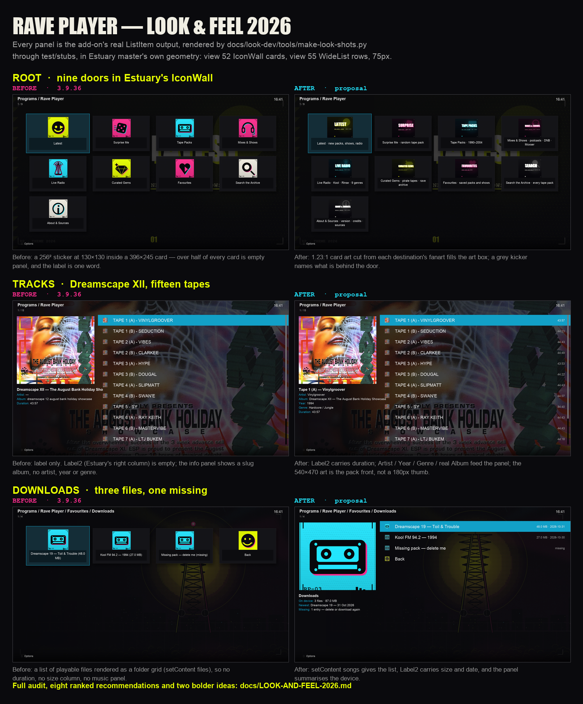

*One-page board: `docs/look-dev/board-before-after.png`.*

---

## 0. The headline

The artwork pass of 3.9.16 gave every destination a distinct sticker and
fanart, and that work holds up. What is **still weak is not the art — it is
everything the skin draws around it**:

1. **Rows carry one line of text and nothing else.** `setLabel2` is called
   **zero times** in the add-on. Estuary's list rows have a right-hand column
   (`ListItem.Label2`) that is empty on every Rave Player screen; the IconWall
   card has a 356×75 label plate showing a single word.
2. **The description the add-on writes is invisible in Estuary.** On Kodi 22
   the add-on deliberately writes copy to the music `comment` field
   (`kodi.music_info`), but Estuary's list/info panels read
   `ListItem.Plot` — which Kodi resolves from the **video** InfoTag only
   (`VideoGUIInfo.cpp`, `case LISTITEM_PLOT`). So on the Shield, in Estuary,
   all of that copy lands nowhere.
3. **Track rows throw away metadata the add-on already parsed.** `nowplaying`
   extracts DJ, venue and date; `archive_item` sets `album` to a raw identifier
   slug (`dreamscape 12 august bank holiday showcase`) and never sets `artist`,
   `year`, `genre` or `tracknumber`, even though Estuary's song panel has a
   labelled line for each.

Those three are cheap to fix and change every screen. The rest of this document
ranks them, shows a mockup for each, and is explicit about what no add-on can
do without forking the skin.

---

## 1. What Kodi actually draws (so the mockups are not fiction)

Read from `xbmc/xbmc` master, `addons/skin.estuary/`:

| Fact | Evidence | Consequence for the add-on |
|---|---|---|
| Plugin folders open in **MyPrograms.xml**, whose default view control is **52 (IconWall)** | `MyPrograms.xml`: `<defaultcontrol>52</defaultcontrol>`, `<views>50,52,55,500</views>` | The default screen is a 4-column card grid, not a list |
| IconWall card: **396×245** in a 440×280 cell; art window **160×130** at (120,20); label plate **356×75** at (20,150), font12, centred, 2 lines max | `View_52_IconWall.xml` | ~55 % of each card is empty panel; a 1:1 sticker fills 130×130 of a 160×130 window |
| Focused card: **zoom 112 %** + `button_focus` tint | same | The only motion on the root screen is the skin's 200 ms zoom |
| List rows: **75 px**, label at x+105, `ListItem.Label2` right-aligned, 32 px status icon at x+35 | `Constants_1080.xml` (`list_item_height` 75), `View_55_WideList.xml` | A row's second column exists and is unused |
| For `Container.Content(songs)`, Estuary uses the List/WideList row layout, and the info panel prints **Track / Artist / Album / Year / Genre / Duration / Playcount** | `Variables.xml` → `ListBoxInfoVar` | The panel is a spec sheet waiting for InfoTag fields |
| `ListItem.Plot` is resolved from the **video** InfoTag | `xbmc/guilib/guiinfo/VideoGUIInfo.cpp` | Music `comment` never reaches Estuary's plot textbox |
| Skin palette has `grey`, not `gray`; Kodi also loads `system/colors.xml` (CSS3 names) | `colors/defaults.xml`, `system/colors.xml` | `[COLOR gray]` works (it is CSS gray `#808080`) but is not theme-aware |
| Notifications: `Notification(...)` string is parsed by `SplitParams`; commas and `()`/`[]`/`""` are syntax | `kodi.notify`, `builtin_text` (in flight on this worktree) | Toasts can silently vanish; they are also the *only* feedback on empty screens |

**What the mockups are:** real ListItems, Estuary geometry, Arial substituted
for Estuary's font, and the fanart dimmed the way `DefaultBackground` does.
**What they are not:** a device capture. Focus animations, the poster-panel
fade (`fadetime 200–300 ms`), the skin's font metrics and the exact background
wash are approximations. Anything that depends on those is flagged
"verify on the Shield".

**One open question for the Shield:** for `Container.Content(songs)`,
Estuary's IconWall has no songs layout, so a track list must be drawn by view
50 or 55. The track mockups use **view 55 (WideList)**, the only MyPrograms
view with an explicit `Container.Content(songs)` row layout. Confirm which view
the Shield lands on after `setContent("songs")` — QA §3 should record it.

---

## 2. Current state

### 2.1 Root — Estuary 52 IconWall

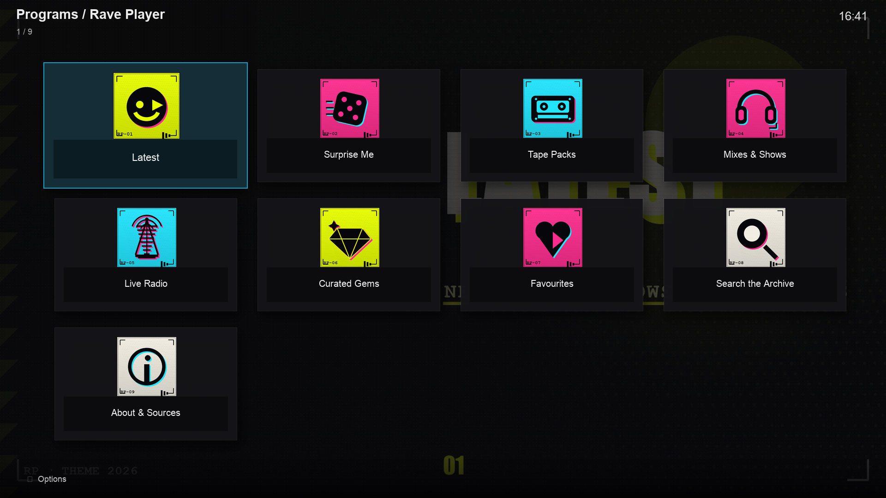

Nine cards, four per row, one row and a bit. Each card is a dark plate with a
130×130 sticker in a 160×130 window, a black label strip and one word. The
fanart behind is the focused destination's, which is the add-on's per-row
fanart doing its job.

### 2.2 Tape Packs hub

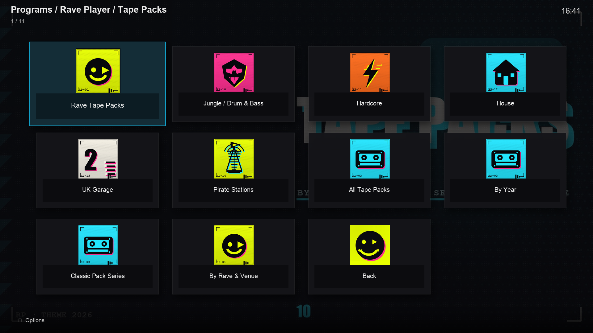

Same grid, eleven doors. The hub fanart is shared across rows (by design in
3.9.16), so the background does not change as you move.

### 2.3 Track list — Dreamscape XII (real archive.org item)

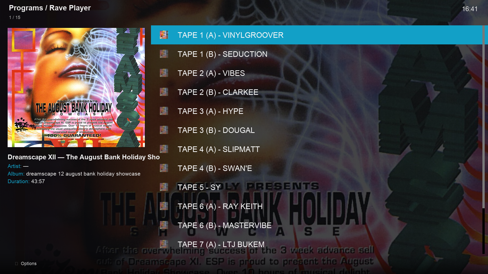

Real data: 15 audio files from
`archive.org/details/dreamscape-12-august-bank-holiday-showcase-1994`, real
titles (`TAPE 1 (A) - VINYLGROOVER`), real durations. Left panel: the pack
front, then four lines — title, `Artist: —`, a slug album, duration.

### 2.4 Favourites → Downloads

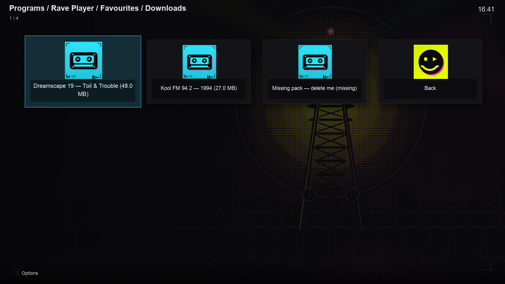

Three sample downloads (the same deterministic index the theme pass uses) plus
`Back`. Rendered as cards because `downloads_menu` ends the directory with
`setContent("files")` even though every row is a playable file.

### 2.5 About & Sources

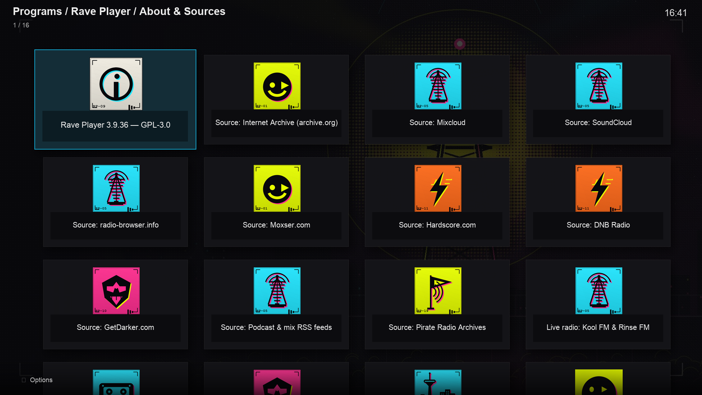

Sixteen cards: fifteen information rows plus `Back`. Eight distinct icons, one
of them (`radio.png`) five times. Two rows are cut off below the fold and there
is no visual grouping.

### 2.6 Empty state

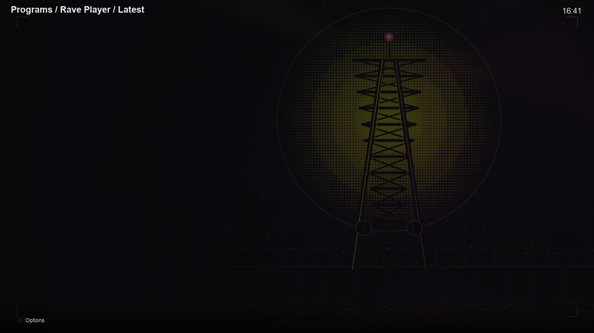

This is what a failed `Latest` load leaves behind: an empty folder plus a
four-second toast that has usually gone before the screen paints.

### 2.7 Context menu

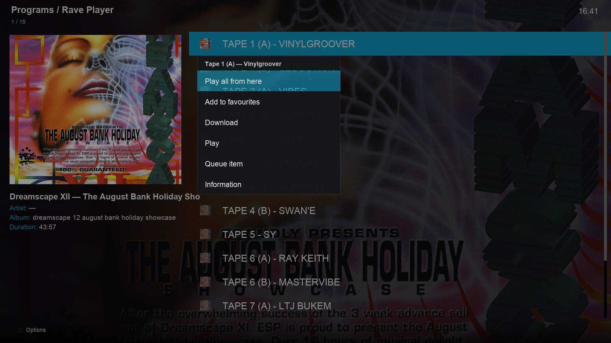

Real entries for a track: `Play all from here`, `Add to favourites`,
`Download`, then Kodi's own `Play`, `Queue item`, `Information`.

---

## 3. The audit

Severity is judged on the Shield at 3 m, Estuary, no skin fork.

### 3.1 Sparse rows — **high**

The add-on emits **one string per row**. Estuary draws label + Label2 + status
icon. On the root that means a 396×245 card whose only content is a 130 px
sticker and one word; in a list it means a 75 px row with a title and 1,000 px
of empty space to its right.

Measured on the real data: `setLabel2` appears **0 times** in
`resources/`; `addSortMethod` **0 times**. Every list in the add-on is
label-only.

### 3.2 The description is written to a field Estuary does not read — **high**

`kodi.music_info()` puts copy in `comment` and only adds `plot` on Kodi < 22,
because Kodi 22 logs an error for a music `plot` key. That is correct API hygiene, but Estuary's panels read
`ListItem.Plot`, which Kodi resolves from the *video* InfoTag. Net effect on
Kodi 22 + Estuary:

- About & Sources: fifteen descriptions, all invisible.
- Downloads: "Downloaded · Archive.org · 2026-10-31", invisible.
- Root/hub: the one-sentence "what is behind this door", invisible.
- Track list: `nowplaying`'s "Vinylgroover · Dreamscape XII · 26 Aug 1994"
  survives only because it is *prefixed into the same comment string*.

The music info dialog (context menu → Information) still shows it, so the copy
is not wasted — it is just not on screen while browsing.

### 3.3 Track rows ignore parsed metadata — **high**

`nowplaying.parse()` returns `artist`, `venue`, `date`; `archive_item` uses it
only to build a comment string, then sets:

```python
album=identifier.replace("-", " ")   # routes.archive_item -> "dreamscape 12 august bank holiday showcase"
duration=track.get("duration")
```

No `artist`, `year`, `genre`, `tracknumber`. Estuary's song panel renders
`Artist:`, `Year:`, `Genre:`, `Track:` lines from those fields; today three of
them are blank and the fourth is a slug. The same fields drive the music OSD
while a tape plays, which is why "now playing" looks thin.

### 3.4 Art loses to the slot it is drawn into — **medium-high**

- Estuary's IconWall art window is **160×130 (1.23:1)**; the add-on ships 1:1
  stickers, so each renders at 130×130 with empty shoulders.
- The list panel is **540×470**; archive thumbnails come from
  `archive.thumb()` = `https://archive.org/services/img/<id>`, which returns a
  **180 px** image. On the Dreamscape XII item the real front cover is
  1699×2485 — a 9× sharper source the add-on never asks for.
- About uses eight icons for sixteen rows.
- 3.9.16 fixed the duplicate-icon bugs, but the vocabulary is still
  "one sticker per destination" while Estuary mostly shows one image at a
  time, large.

### 3.5 Label / typography — **medium**

- Budget: Estuary's card plate is 350 px at font12 → about **34 characters**
  before wrapping, and a 2-line clip. About's longest labels are 38 and 36
  characters (`Source: Internet Archive (archive.org)`,
  `Source: Toronto Rave Mixtape Archive`).
- The prefix `Source:` repeats on 14 of 15 About rows — pure noise in a grid.
- Hierarchy inside a label is impossible in a list (single-line, scrolls), so
  the only way to separate title from metadata is `Label2` (list) or wrapping
  inside the card plate (IconWall).
- Case is inherited from the source: `TAPE 1 (A) - VINYLGROOVER` next to
  `Dreamscape XII — The August Bank Holiday Showcase`.
- One real label bug: some archive items carry URL-encoded filenames
  (`ct_Dreamscape_14_29.10.94` → `Dreamscape+14+-+Darren+Jay`). `_pretty()`
  (`resources/lib/archive.py`) replaces `_` but not `+`. Two of the three real items I
  sampled were clean, one was soup.
- `[COLOR gray]` is used 19 times. It resolves to CSS grey `#808080` from
  Kodi's system colour table, so it works — but it is skin-independent, and a
  light skin would lose the contrast.

### 3.6 Focus clarity — **skin-owned, but we can help**

Estuary signals focus with a 112 % card zoom + `button_focus` tint, or a cyan
row bar; that is all skin. What the add-on controls is *what changes*: the
focused item's fanart washes the background and, in list views, its art fills
the side panel. So focus clarity is an **art variance** problem: nine
destinations with nine different stills read as focus; two rows sharing art
(the old tapepacks/surprise collision) read as a stuck screen.

### 3.7 Motion — **low, mostly impossible**

The add-on owns motion only in windows it draws itself: the 3.9.19 tuning
spinner, the 3.9.35 Surprise reveal, `DialogProgress`, notifications. Directory
screens have no motion the add-on can author; the skin cross-fades fanart,
zooms the focused card and slides panels in, all on its own timings. "More
motion" therefore means "more overlay windows", not "more animated rows".

### 3.8 Now playing — **medium**

While a tape plays, Kodi's OSD shows title / artist / album. Today: title from
the track, artist blank, album the identifier slug. The venue and date the
add-on parsed are in the comment, which the OSD does not show. The 3.9.19
spinner and 3.9.35 reveal prove the team can ship a WindowXML overlay; a
now-playing surface is the same technique.

### 3.9 Context menus — **medium-low**

Kodi's context dialog is a flat, unstyled 450 px list; the add-on controls only
the strings and their order. Today the order is emission order, the labels mix
"Play all" and "Play all from here", there is no `Queue`, and `Delete download`
sits next to `Play` on the downloads screen.

### 3.10 Empty and error states — **medium-high**

71 `kodi.notify()` calls. On failure the pattern is: toast → empty directory.
A toast is 4 s, unreadable at distance, and (per the in-flight
`builtin_text` fix) can be dropped entirely when a title contains `(` or `,`.
The empty screen has no rows, no retry and no explanation.

### 3.11 Terminators and chrome rows — **low**

`End of list` is a real row with the add-on icon, styled like content. `Back`
rows exist at the bottom of hubs and About, adding a sixteenth card to About,
although Estuary already binds Back. The 3.9.16 pass left both untouched.

---

## 4. Top 8 improvements, ranked by impact ÷ effort

Impact: how much of the screen changes on the Shield. Effort: S (< ½ day),
M (1–2 days), L (3+). Risk: what can regress on a device we cannot see.

| # | Change | Impact | Effort | Risk |
|---|---|---|---|---|
| 1 | Label2 + grey kicker on every row | High | S | Low |
| 2 | Give the description a visible field | High | S–M | Medium |
| 3 | Track InfoTags: artist, real album, year, genre, track number | High | S | Low |
| 4 | Art for the slot: 1.23:1 card art + full-size pack covers | Medium-high | S–M | Low |
| 5 | `setContent("songs")` where the rows are songs | Medium-high | S | Low |
| 6 | Empty/error states as rows you can act on | Medium-high | S | Low |
| 7 | About & Sources: eight doors, not sixteen cards | Medium | S | Low |
| 8 | Context menus: verb-first, ordered, Queue added | Medium | S | Low |

---

### 4.1 Label2 + a grey kicker — **do this first**

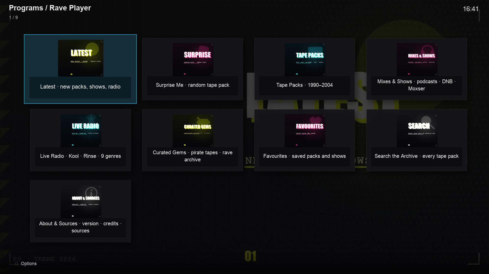

*Estuary 52 IconWall after: card art cut to the 1.23:1 slot, label carries a
kicker. The numbered-callout version is `look-dev/proposed/root.png`, and every
proposal below has a clean and an annotated variant side by side.*

Three things happen in one edit:

1. **List views** get a right-hand column: duration for tracks, size · date for
   downloads, item count for hubs. Estuary already draws it, greyed on
   unfocused rows.
2. **IconWall cards** get a second line for free: the same string wraps inside
   the 356×75 plate, so a door reads `Tape Packs · 1990–2004` instead of
   `Tape Packs`.
3. The label is still a single string, so nothing else in Kodi changes — the
   top-bar breadcrumb, the info dialog and the OSD all keep working.

**Sketch**

```python
# resources/lib/ui.py
item = xbmcgui.ListItem(label=label)          # unchanged
item.setLabel2(label2 or "")                  # new: right column / card second line

# examples
# root row:      label="Tape Packs",  label2="1990–2004"   (or kicker in the label)
# hub row:       label="Jungle / Drum & Bass", label2="1,204"
# track row:     label="TAPE 1 (A) - VINYLGROOVER", label2="43:57"
# download row:  label="Dreamscape 19 — Toil & Trouble", label2="48.0 MB · 31 Oct"
```

Rules that keep it safe on any skin: **Label2 ≤ 16 characters**, digits and a
separator only, never the primary identity; keep the total label ≤ 34 chars so
the card wraps once and the list does not scroll. The card half of this change
is the mockup above; the list half is visible in §4.2 (durations) and §4.5
(size · date).

**Risk:** on very narrow skins Label2 can collide with the status icon; on
Estuary it is measured at x+105 → right-40, i.e. ~1,700 px, so there is room.
Low risk, big payoff — this is the single recommendation.

---

### 4.2 Give the description a visible field


*Annotated: `look-dev/proposed/tracks.png`. The panel is Estuary's
`ListBoxInfoVar`; every line is an InfoTag field.*

Today's copy goes to `comment`, which Estuary never reads on Kodi 22. Three
options, in order of preference:

**A. Feed the fields Estuary actually reads (no hack).** For songs, Estuary
prints `Artist`, `Album`, `Year`, `Genre`, `Duration`, `Track`. Setting those
(see 4.3) fills the panel with real structure — no plot needed. This covers
every track list, which is where a description matters most.

**B. Put the one-liner in Label2** (4.1). If a row needs a short "what is
this", it belongs in the secondary column, not in a plot nobody sees.

**C. Experiment: add a minimal video InfoTag for `plot`.** Kodi allows both
tags on one ListItem; `ListItem.Plot` would then resolve from the video tag.
This is untested on the Shield and could change the player's media handling or
the OSD layout, so gate it behind a setting, test on the Shield, and keep the
music tag authoritative for playback. **Do not ship it blind.**

What not to do: move copy into the label itself. `Latest` already does that
(`Title  [COLOR gray](source · date)[/COLOR]`), and in Estuary's big poster
title it renders the source and date at 52 px, greyed — the string is fine at
row size and wrong at panel size.

**Sketch (A):** in `routes.archive_item`, stop prefixing `nowplaying.plot()`
into one string and set fields:

```python
details = nowplaying.parse(pack_title, track["title"])
ui.track_item(..., plot=comment, artist=details["artist"],
              album=pack_title, year=year_from(details["date"]),
              genre="Hardcore / Jungle", trackno=index + 1)
```

**Risk:** medium only for (C). (A) and (B) are additive.

---

### 4.3 Track InfoTags — the panel is a spec sheet, fill it

Same screenshot as 4.2. Concretely, in `archive_item`:

| Field | Today | Proposed | Source |
|---|---|---|---|
| `title` | track title | unchanged | `archive.audio_files` |
| `artist` | — | `details["artist"]` (`"Vinylgroover"`) | `nowplaying.parse` |
| `album` | `identifier.replace("-", " ")` | `archive.item_title(id)` → `"Dreamscape XII — The August Bank Holiday Showcase"` | already fetched |
| `year` | — | `1994` from `details["date"]` | `nowplaying.find_date` |
| `genre` | — | pack-level genre (`Hardcore / Jungle`) | route context |
| `tracknumber` | — | index + 1 | loop index |
| `duration` | seconds | unchanged | archive |

Estuary then prints `Track: 01. TAPE 1 (A) …` / `Artist: Vinylgroover` /
`Album: …` / `Year: 1994` / `Duration: 43:57` in the panel, and the OSD gets an
artist line instead of a blank. The same fields are what a future "now playing"
overlay would bind to.

**Risk:** low. Watch one thing: `tracknumber` changes `MusicTrackInfo`'s prefix
in the panel (`01. Title`); it does not touch the row label.

---

### 4.4 Art for the slot, not for the mood

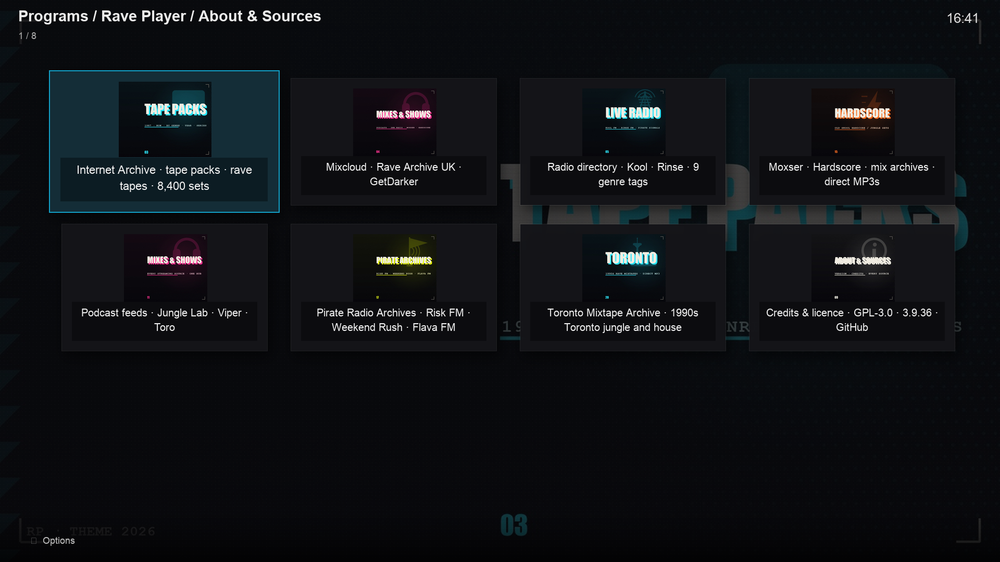

Two separate fixes:

**Card art (1.23:1).** Estuary's IconWall art window is 160×130. Ship a
`card-*.jpg` at 640×520 per destination (a 1.23:1 cut of the fanart's type
side, word and sun kept in frame), set it as `thumb`/`icon`, and keep the
square sticker for `poster`/other views. The sticker is a 64 px object; the
card is a 130 px one. The mockup shows the same fanarts, re-cut.

**Pack art at full size.** `archive.thumb()` asks archive.org for a 180 px
service thumbnail; the item already exposes `FRONT.jpg` at 1699×2485. Prefer
the largest image in the item's file list (`https://archive.org/download/<id>/<name>`)
and fall back to `services/img`. That is one function change and makes every
list panel sharp.

**Icon vocabulary for text pages.** About reuses `radio.png` five times. Text
pages should use a small set of *category* marks (archive / cloud / radio /
feed / credits), not source stickers.

**Risk:** low, but art is cached by path — new filenames avoid the 3.9.16
texture-cache trap; reusing filenames needs the "restart Kodi once" note again.

---

### 4.5 Content types: declare songs where the rows are songs

`downloads_menu` ends with `setContent("files")` (`routes.downloads_menu`) although
every row is a playable track. `fav_list` correctly declares `songs`
(`routes.fav_list`). Consequences of the mismatch:

- Estuary gives Downloads the folder grid: no duration, no size column, no
  music panel, no "now playing" integration.
- The two screens that show the same kind of object look unrelated.

**Sketch:** `kodi.end_directory(handle, "songs")` in `downloads_menu`; keep
`files` for root, hubs, About and search results. While there, add
`xbmcplugin.addSortMethod(handle, xbmcplugin.SORT_METHOD_UNSORTED)` (or
`SORT_METHOD_TRACKNUM` in track lists) so the skin's sort label is stable —
currently `addSortMethod` is called **0 times**, so the skin shows no sort
method at all.

**Risk:** low, but it changes which Estuary view is eligible. QA: open
Downloads on the Shield and confirm rows still render.

---

### 4.6 Empty and error states as rows

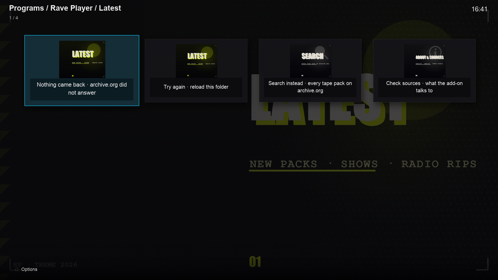

Yesterday's failure mode: toast + empty folder. Proposed: the route emits two
to four real rows — *Nothing came back · archive.org did not answer*,
*Try again*, *Search instead*, *Check sources* — each a normal folder with real
art, so the screen explains itself and offers the next step. Notification stays
as the transient signal, not the only one.

**Sketch**

```python
if not docs and page == 1:
    kodi.notify("Nothing came back from the Archive. Try another section.")
    ui.menu_item(handle, url_for(mode="archive_list", key=key), "Try again",
                 icon=art("rave.png"), plot="Reload this folder.")
    ui.menu_item(handle, url_for(mode="search"), "Search instead",
                 icon=art("search.png"), plot="Search every tape pack.")
    kodi.end_directory(handle, "files")
    return
```

Apply to: `archive_list`, `latest_view`, `search`, `fav_list` (no favourites),
`downloads_menu` (no downloads), `moxser`/`hardscore` when the source is down.

**Risk:** low. One trap: don't make these rows playable, or Kodi may walk into
them (the 3.9.8 endless-scroll lesson).

---

### 4.7 About & Sources: eight doors, not sixteen cards

See `look-dev/proposed/about-clean.png`. Today: 15 rows + Back, 8 icons, five
`radio.png`, 38-character labels, no grouping. Proposed: one card per source
family (Internet Archive, Mixcloud, radio directory, Moxser·Hardscore, podcast
feeds, Pirate Radio Archives, Toronto, credits), each with its own art and a
kicker naming what it carries. Total 8 cards on one screen, all labels inside
the plate budget.

**Why it matters beyond aesthetics:** the About screen is the credibility
surface — it is where a user checks that the sources are real. Sixteen
identical-looking cards is the opposite of a source list.

**Risk:** low (copy only). Keep the per-source detail reachable — a detail
dialog or a second level — so nothing is actually lost.

---

### 4.8 Context menus: verb-first, ordered, Queue added

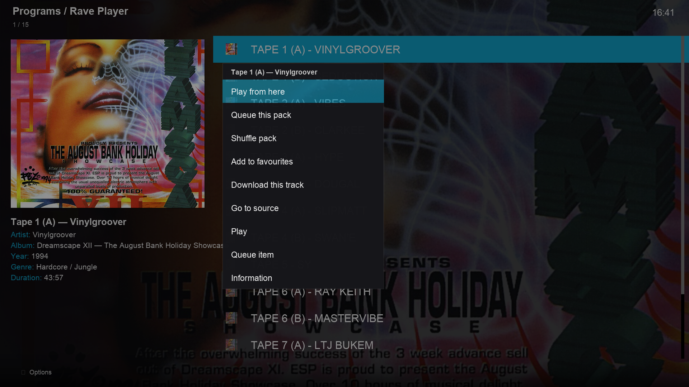

Kodi's context dialog is a flat 450 px list, 65 px rows, unstyled. The add-on
controls text and order only. Proposal:

| Screen | Today | Proposed order |
|---|---|---|
| Track in a pack | Play all from here · Add to favourites · Download | **Play from here** · Queue this pack · Shuffle pack · Add to favourites · Download this track · Go to source |
| Pack row | Play all · Shuffle pack · Add to favourites | Play all · Shuffle pack · Add to favourites |
| Download | Delete download | Play · Add to favourites · Delete download (last) |

Rules: verb first, ≤ 22 characters, one spelling of "play all", destructive
items last and never first, `Queue` promoted (Kodi's own Queue is buried two
levels down). Kodi appends its built-ins below ours — that is fine and gives a
natural "system actions" block.

**Risk:** low; labels only.

---

### Also worth doing (not in the top 8)

- **Terminators.** `End of list` with the add-on icon reads as content. Make it
  `[COLOR gray]— end of list —[/COLOR]` with a neutral icon, or drop it where a
  folder cannot auto-advance. Drop the `Back` rows on hubs/About (Estuary
  already binds Back) and the sixteenth About card disappears.
- **Notifications.** Standardise heading (`Rave Player`), message ≤ 60 chars,
  and pick icon by outcome (add-on icon for success, a warning glyph for
  failure). The in-flight `builtin_text` fix should ship: it is the difference
  between a toast and silence.
- **`+` in archive titles.** `_pretty()` should `unquote_plus` and collapse
  `" - "`; today `Dreamscape+14+-+Darren+Jay` reaches the row.
- **Sort method.** Call `addSortMethod` so the skin's sort line is meaningful.
- **Label budget test.** A unit test asserting every emitted label ≤ 34 chars
  and Label2 ≤ 12 would stop the next long row before it ships.

---

## 5. Two bolder ideas

### 5.1 A "tape deck" now-playing overlay (WindowXML)

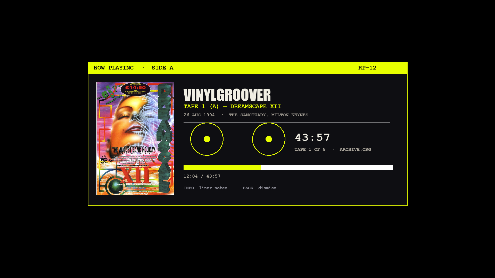

Kodi's OSD is skin-owned and cannot be restyled. An **overlay window the add-on
draws itself** can be: a 1240×560 dialog with the pack front, the DJ set in
display type, venue/date, a reel motif, elapsed/total and progress. The
3.9.19/3.9.35 windows are the precedent — same `WindowXML` machinery, same
`resources/skins/Default/720p/*.xml`.

**Feasibility**

- Trigger: `xbmc.Player().onPlayBackStarted` via a `Monitor`/service, or an
  explicit "Now playing" context action; auto-hide after ~6 s, `Back` to
  dismiss, `INFO` for liner notes.
- Data: `Player.GetItem` (JSON-RPC) gives title/artist/album/thumbnail; the
  add-on's `nowplaying` data can ride along on the item's properties.
- Progress: `Player.GetProperties(["percentage","time","totaltime"])`, polled
  at 1 Hz while visible (cheap; one JSON-RPC call/second).
- Cost: 1 XML + ~150 lines Python, 2–3 days with device testing.
- Risks: dialog-vs-fullscreen z-order (use `WindowXML` non-modal as the
  spinner does, not `WindowModal`), and OSD fights — hide the overlay while
  Kodi's OSD is open (`Window.IsVisible(videoosd)` equivalent is not available
  to the add-on; safest is to show it only on explicit request).
- **Recommendation:** ship it behind the existing `spinner_overlay` pattern,
  default off, and let the Surprise/tuning windows prove the machinery first.

### 5.2 Focus-driven fanart transitions

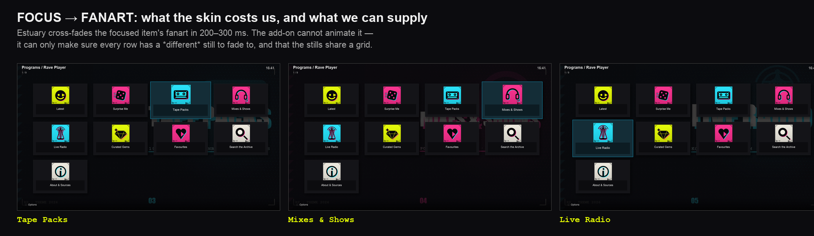

What exists: Estuary already cross-fades the focused item's fanart
(`fadetime 200–300 ms`), zooms the focused card to 112 % and slides panels.
What the add-on cannot do: author that animation. What it *can* do is make the
transition worth watching — nine destinations with nine distinct, same-grid
stills, so moving across the root reads as a slideshow of the archive rather
than a stuck image.

The bolder version — an animated "ambient" layer (grain, tape hiss meter,
rotating pack art) behind the directory — needs either (a) an animated texture
the skin draws (not ours to add), or (b) a permanent full-screen overlay window
under the list, which would fight the skin's background and every view change.
**Verdict:** not worth it in Estuary. Spend the effort on 5.1 instead, where
the add-on genuinely owns the surface.

A cheaper middle ground: ship a small set of **10-second looping `fanart`
WebPs** *if* the Shield's Kodi build animates them in image controls (test
first — support varies by version and is not something this pass could verify
without the device). If it animates, a subtle loop on the root fanart is the
only "motion" available without a skin fork; if it does not, it degrades to a
static first frame.

---

## 6. Impossible without a skin fork

| Want | Why it is out of reach |
|---|---|
| Bigger cards, fewer columns, list-first layout | `View_52_IconWall.xml`, `MyPrograms.xml` `<views>`/`<defaultcontrol>` |
| A taller/denser row, row padding, dividers | `list_item_height` = 75 in the skin constants |
| A different font, size, weight or letter-spacing | skin fonts; only `[B]`/`[I]`/`[COLOR]` markup |
| Focus colour, focus animation, card zoom, sounds | skin palette + `View_52` animations |
| Showing Label2 in the IconWall label plate | the plate renders `ListItem.Label` only |
| Making `Item.Plot` render for music rows | Estuary reads `ListItem.Plot`; Kodi maps it to the video tag |
| Restyling the context menu, notifications, OSD | Kodi dialogs; add-on passes text only |
| Screen transitions, parallax, per-view art | skin animation system |
| Removing the folder overlay icon / scrollbar | skin |
| A "poster wall" for tape packs | would need a skin view that draws `poster` at library size |

The honest summary for the owner: **the add-on writes content; Estuary decides
how content looks.** Every recommendation above works *with* that constraint —
labels, Label2, InfoTags, art ratios, content type, row-level empty states —
which is why none of them needs a skin.

---

## 7. An Estuary settings pass (no fork, no add-on change)

What a user can change today (Estuary Settings, Kodi 22):

| Setting | Recommended | Effect |
|---|---|---|
| Artwork → *Show media fanart as background* | **On** | The per-row fanart this add-on ships becomes visible; off, the root is a black grid |
| Artwork → *Choose background pattern* | subtle / none | Busy patterns fight the sticker halftone |
| General → *Use slide animations* | On (default) | Gives the only screen-transition motion available |
| General → *Enable auto scrolling for plot & review* | On | Long labels scroll instead of clipping |
| General → *Show media flags* | Off for add-ons | Flags rarely populate for plugin rows; the bar is mostly dead space |
| Colour theme (curial / flat) | flat | Slightly higher contrast behind the cards |
| View menu (per folder) | IconWall (52) for doors; WideList (55) for tracks — List (50) has no `files` layout | The only "layout" control a user has |

What it cannot fix: row height, fonts, card size, Label2 presence, focus
colour, poster panel geometry. **Do not** ship a settings profile as a
requirement — the add-on must still look correct on a default install, which is
what the mockups assume.

---

## 8. What to verify on the Shield (QA additions)

1. Which view Estuary lands on after `setContent("songs")` on a track folder
   (view 50 vs 55). Record it in `docs/QA-KODI.md`.
2. Label2 renders on: root? (no — IconWall has no Label2), hub list, track
   list, Downloads after 4.5. Screenshot each.
3. After 4.3, the panel shows Artist/Year/Genre and the OSD shows an artist
   line while a tape plays.
4. `Item.Plot` experiment (4.2C): does a video InfoTag on a music item change
   the OSD, playback or the playlist? Only then decide.
5. Full-size pack art loads and caches (watch for a stall on first paint).
6. Card art at 640×520 does not shimmer on the 4K TV.
7. Context menu order after 4.8, and that `Queue` does not break the
   "no auto-advance" work from 3.9.8.

---

## 9. Reproduce

```sh
# mockups (dev-only; no network needed: the archive fixture is committed)
python3 docs/look-dev/tools/make-look-shots.py
# -> docs/look-dev/current/*.png, proposed/*.png, capture.json,
#    board-before-after.png

# the add-on's own suite is untouched by this pass
python3 -m unittest discover -s test
```

Files added by this audit:

```
docs/LOOK-AND-FEEL-2026.md          this document
docs/look-dev/board-before-after.png
docs/look-dev/current/              root, packs, tracks, downloads, about, empty, context
docs/look-dev/proposed/             the same plus proposals, overlay, focus strip
docs/look-dev/capture.json          the captured ListItems the renders came from
docs/look-dev/assets/               real pack front (1699×2485) + archive thumb
docs/look-dev/tools/make-look-shots.py   renderer (stubs + Estuary geometry)
docs/look-dev/tools/fixtures/archive-packs.json  real archive data, offline
```

**Data provenance:** `dreamscape-12-august-bank-holiday-showcase-1994` (15
tracks, clean titles) and `ct_Dreamscape_14_29.10.94` (10 tracks, `+`-encoded
titles) captured from archive.org on 2026-11-03; downloads are the theme pass's
deterministic sample index; everything else is the add-on's current output.

**Working tree note:** this pass added only `docs/look-dev/` and this file; no
add-on code, tests or artwork were modified, and nothing was committed. The
worktree is shared with concurrent, unrelated work (notification parsing,
spinner overlay, art renames, HTML-entity decoding), so the tree moved while
this audit ran. The captures were taken against 3.9.36 as it stood during the
pass — re-running the renderer later may pick up different artwork names and
decoded labels from that other work, which is expected and is not part of this
audit.

---

## 10. If only one thing ships

**Label2.** It is the only change in this document that touches every list
screen, costs one line in `ui.add_item`, cannot break playback, and gives the
add-on the hierarchy it currently lacks: title on the left, fact on the right,
in a column Estuary already draws and no Rave Player row has ever filled.
