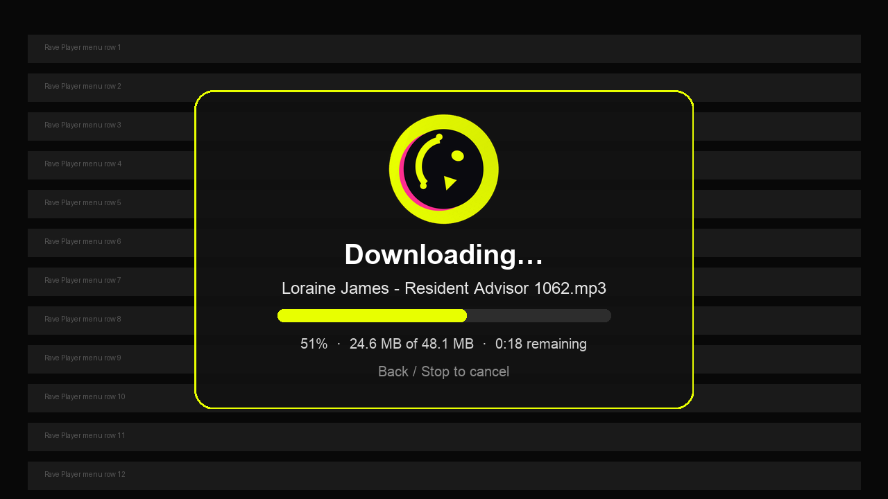

# Spinning-head download window — 3.9.19 prototype (Kodi)

> Opt-in prototype. Default Kodi behaviour is unchanged: the existing
> `DialogProgress` remains the default; enable **Settings → General →
> Spinning-head download window (prototype)** to try it.



Short capture: [spinner-preview.gif](spinner-preview.gif) (10 frames, 10 fps).

## What it is

When a download starts and `spinner_overlay` is enabled, the add-on creates a
small custom `xbmcgui.WindowXML` overlay (`resources/skins/Default/720p/raveplayer-spinner.xml`)
instead of the plain `DialogProgress`:

- the Rave Player smiley-head rotates through 10 pre-rendered PNG frames at
  256px (also generated at 128px for lower-density skins), 36° per frame,
  10 fps (the frame is derived from elapsed download time);
- filename, percent, `done of total`, remaining time and “Back / Stop to cancel”;
- non-modal: `show()` returns and the download loop calls `update()`; no
  separate animation thread and no blocking Kodi loop;
- closes on success/cancel/failure in a `finally`; if the window cannot be
  created (missing skin, platform quirk), the existing `DialogProgress` is used
  automatically. Failures in `update()` close the overlay but never stop the
  download.

## Files / controls

| File | Purpose |
|---|---|
| `resources/lib/spinner.py` | frame math, formatting, `SpinnerWindow` wrapper, fallback/action handling |
| `resources/skins/Default/720p/raveplayer-spinner.xml` | window layout: image 100, filename 101, percent 102, size 103, remaining 104, hint 105, progress 106 |
| `resources/art/spinner/head-{128,256}-00…09.png` | 10 rotated frames ×2 sizes, transparent circular crop |
| `scripts/make-spinner.py` | deterministic Pillow regeneration (`python3 scripts/make-spinner.py`) |
| `docs/spinner-preview.png/.gif` | layout preview / short capture (mock, not a device capture) |

Frame index = `int(elapsed * 10) % 10`; format: `head-256-XX.png`.
The icon is alpha-masked to its circular head before rotation, so the yellow
square corners do not spin.

## Lifecycle

```
download_start (RunPlugin)
  plan + confirm (size/free)            ← unchanged 3.9.18
  if setting spinner_overlay:
      SpinnerWindow().open()            ← fallback to DialogProgress if False
  downloads.download(plan,
      progress=overlay.update(done,total,elapsed,title),
      cancelled=overlay.iscanceled)
  finally: overlay.close() / dialog.close()
  success/cancel/failure notification
```

Back/Stop on the overlay sets `_rave_cancelled`; `SpinnerWindow.iscanceled()`
picks it up and the download loop removes the `.part` file. The existing
`DialogProgress.iscanceled()` path remains for fallback.

## Tests

`test/test_spinner.py` — frame files/sizes/XML, frame-index wrapping, byte/
remaining formatting, open/update/close lifecycle with a fake WindowXML,
open failure, cancel state. `test/test_download_routes.py` — overlay selected
and closed on success, and automatic fallback to `DialogProgress` when the
window fails. Full suite **403 tests OK**.

## Cost / risks

- **Cost:** 20 small PNG frames (~512 KB total), one 4 KB XML, ~200 line wrapper;
  no new dependencies at runtime (Pillow is dev-only for regeneration).
- **Non-modal assumption:** Kodi’s `WindowXML.show()` is expected to return
  without blocking. If a future Kodi/skin makes it modal, the download would run
  behind the window; mitigation is the opt-in default + fallback setting off.
- **Animation smoothness:** frames advance from download-loop progress, so a
  long network stall shows a still frame rather than a stutter loop. A separate
  animation thread was deliberately avoided (Kodi UI thread-safety risk).
- **Skin compatibility:** custom window XML is authored for Estuary 720p; other
  skins should still load it, but layout is not adapted. The fallback covers
  total failure.
- **Focus/cancel:** the overlay is a dialog; Back/Stop cancellation depends on
  Kodi routing the action to it. The fallback progress dialog is the reliable
  cancel path if the window misbehaves.
- **No device test yet:** this branch is the prototype the owner will install
  on the Shield; no Shield capture was available while building it.

## Recommendation

Keep the existing progress dialog/notification as the **default**; ship this as
an **opt-in setting** for the Shield trial. If it proves smooth and stable,
consider making it the default and removing the plain dialog (or keeping it as
fallback) in a later release. Replacing the notification outright now would
couple a cosmetic prototype to the 3.9.18 download flow and make regressions
harder to bisect.
